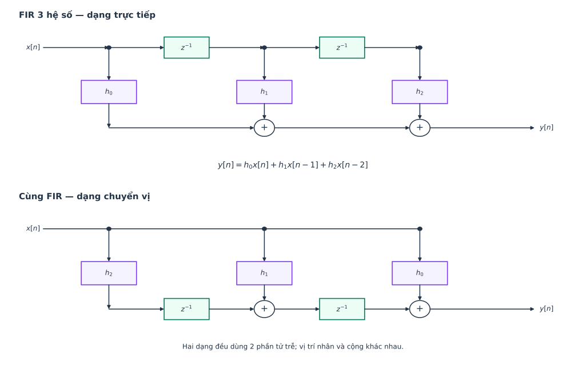
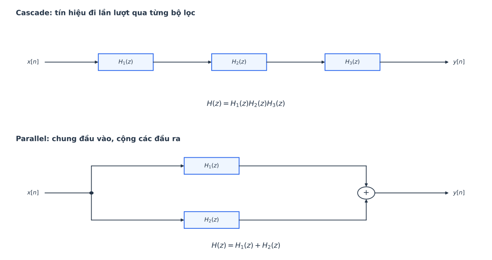
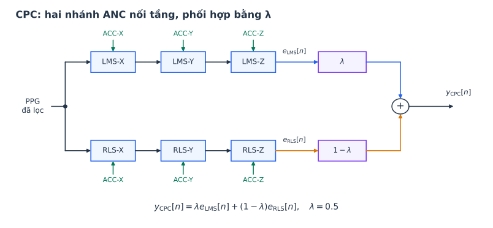
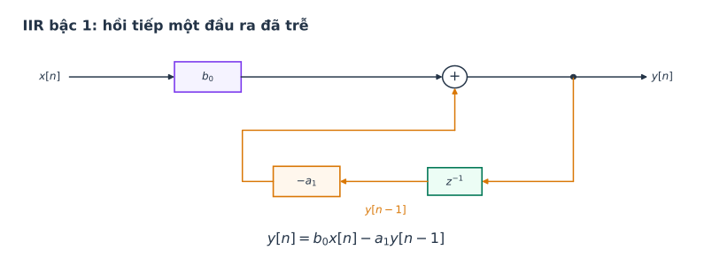
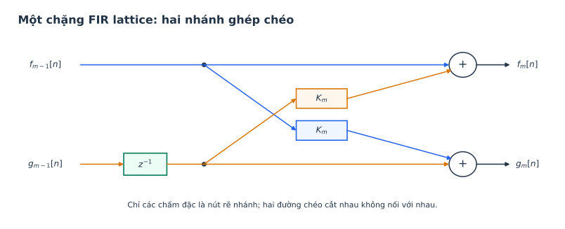
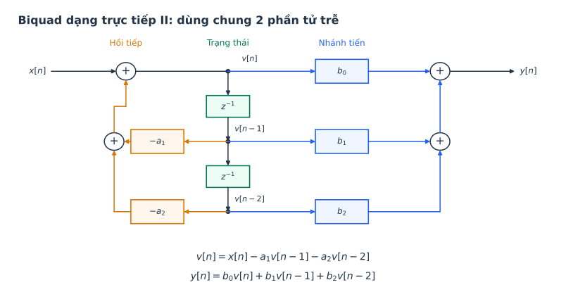
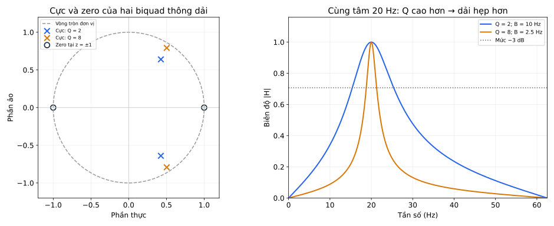

# Lecture 02 — Cấu trúc bộ lọc

**Môn học:** ET6021 — Xử lý tín hiệu số nâng cao
**Mục tiêu:** Hiểu các cấu trúc FIR, IIR, Cascade, Parallel và liên hệ với đồ án CPC PPG LMS/RLS.

---

## 1. Tại sao cần nhiều cấu trúc bộ lọc? (Slide 3)

Cùng một hàm truyền đạt H(z) có thể được thực hiện bằng nhiều cấu trúc khác nhau.

Các yếu tố quyết định:

- Độ phức tạp tính toán.
- Dung lượng bộ nhớ.
- Kiến trúc phần cứng.
- Sai số lượng tử hóa.
- Độ nhạy với sai số hệ số.
- Khả năng mô-đun hóa và mở rộng.

**Ghi nhớ:** Hai cấu trúc có thể tương đương về mặt toán học nhưng khác nhau về hiệu quả và độ chính xác khi triển khai thực tế.

## 2. Bộ lọc FIR (Slide 5–10)

FIR — Finite Impulse Response: bộ lọc có đáp ứng xung hữu hạn.

**Phương trình:**

$$
y[n]=\sum_{k=0}^{M}h[k]x[n-k]
$$

**Hàm truyền đạt:**

$$
H(z)=\sum_{k=0}^{M}h[k]z^{-k}
$$

Trong đó:

- `x[n-k]`: mẫu đầu vào hiện tại hoặc quá khứ.
- `h[k]`: hệ số bộ lọc.
- `z^{-1}`: phần tử trễ một mẫu.
- Bộ lọc bậc M có M+1 hệ số theo quy ước trên.

### Các cấu trúc FIR

**Dạng trực tiếp (Direct Form):**

- Gồm các phần tử trễ, nhân hệ số và bộ cộng.
- Tính đầu ra bằng tổng có trọng số của các mẫu đầu vào.

**Dạng chuyển vị (Transposed Form):**

- Hoán đổi vị trí các khối cộng, nhân và trễ theo nguyên lý chuyển vị.
- Giữ quan hệ vào–ra tương đương trong số học lý tưởng.

*Hình 1. FIR bậc 2 có ba hệ số: dạng trực tiếp trễ các mẫu đầu vào, dạng chuyển vị trễ các tổng trung gian. Hai dạng trên tương đương khi các hệ số cố định; với trọng số thích nghi cần xét thêm thời điểm cập nhật.*

**FIR pha tuyến tính:**

- Hệ số đối xứng hoặc phản đối xứng:

$$
h[n]=\pm h[M-n]
$$

- Giúp đạt đáp ứng pha tuyến tính trong các trường hợp FIR thích hợp.

**Liên hệ đồ án:**

- Mỗi tầng LMS/RLS sử dụng cấu trúc FIR có trọng số thích nghi.
- LMS sử dụng 27 hệ số; RLS sử dụng 55 hệ số mỗi tầng.
- Không được nhầm số hệ số với bậc bộ lọc: theo quy ước FIR thông thường, 27 hệ số tương ứng bậc 26.

## 3. Cascade và Parallel (Slide 8–9, 24–27)

### Cascade — Ghép nối tiếp

Đầu ra bộ lọc trước trở thành đầu vào bộ lọc sau.

Đối với các hệ LTI cố định:

$$
H(z)=H_1(z)H_2(z)\cdots H_K(z)
$$

### Parallel — Ghép song song

Cùng một đầu vào được xử lý bởi nhiều nhánh, sau đó kết hợp đầu ra.

Đối với các hệ LTI cố định:

$$
H(z)=H_1(z)+H_2(z)+\cdots+H_K(z)
$$

*Hình 2. Cascade truyền tín hiệu qua từng khối; Parallel chia cùng đầu vào sang các nhánh rồi cộng đầu ra. Công thức hàm truyền trong hình xét các hệ LTI cố định.*

### Liên hệ kiến trúc CPC

**Nối tầng trong mỗi nhánh:**

PPG → ANC dùng ACC-X → ANC dùng ACC-Y → ANC dùng ACC-Z.

- Tín hiệu truyền sang tầng sau là sai số khử nhiễu `e[n]`.
- Mỗi tầng có trọng số và trạng thái riêng.
- Hai nhánh sử dụng LMS và RLS độc lập.

**Phối hợp song song hai nhánh:**

$$
y_{CPC}[n]=\lambda y_{LMS}[n]+(1-\lambda)y_{RLS}[n]
$$

Trong đồ án:

$$
\lambda=0.5
$$

*Hình 3. Mỗi ô LMS/RLS là một tầng ANC. Tín hiệu giữa các tầng là sai số sau khử nhiễu; hai sai số cuối được nhân trọng số rồi cộng. Trong ký hiệu ở trên, $y_{LMS}=e_{LMS}$ và $y_{RLS}=e_{RLS}$; chúng không phải tín hiệu dự đoán nhiễu.*

**Lưu ý quan trọng:** Công thức nhân/cộng hàm truyền đạt H(z) áp dụng cho các hệ LTI cố định. Không được mặc nhiên coi toàn bộ CPC thích nghi là một hệ LTI có hàm truyền đạt cố định.

## 4. Bộ lọc IIR (Slide 24–33)

IIR — Infinite Impulse Response: bộ lọc có đáp ứng xung vô hạn, thường sử dụng hồi tiếp đầu ra.

**Phương trình sai phân:**

$$
y[n]=-\sum_{k=1}^{N}a_ky[n-k]
+\sum_{k=0}^{M}b_kx[n-k]
$$

**Hàm truyền đạt:**

$$
H(z)=
\frac{\sum_{k=0}^{M}b_kz^{-k}}
{1+\sum_{k=1}^{N}a_kz^{-k}}
$$

*Hình 4. Ví dụ IIR bậc 1: đầu ra $y[n]$ quay lại qua phần tử trễ để tạo $y[n-1]$, rồi nhân với $-a_1$ trước khi cộng với nhánh vào. Dấu trừ đã nằm trong hệ số $-a_1$.*

Các cấu trúc IIR:

- Nối tiếp: phân tích thành các tầng bậc thấp.
- Song song: phân tích thành các nhánh phân thức.
- Lattice: cấu trúc mắt cáo sử dụng hệ số phản xạ.

**FIR vs IIR:**

| Tiêu chí                   | FIR                         | IIR                                            |
| ---------------------------- | --------------------------- | ---------------------------------------------- |
| Đáp ứng xung              | Hữu hạn                   | Vô hạn                                       |
| Hồi tiếp                   | Thông thường không      | Thường có                                   |
| Ổn định                   | BIBO nếu hệ số hữu hạn | Phụ thuộc cực                               |
| Pha tuyến tính chính xác | Có thể thiết kế         | Khó đạt với IIR nhân quả thông thường |
| Ứng dụng trong đồ án    | LMS/RLS dùng FIR           | Không triển khai IIR thích nghi             |

## 5. Cấu trúc Lattice (Slide 11–22)

Lattice là cấu trúc bộ lọc dạng mắt cáo, sử dụng các hệ số phản xạ K_m.

Đặc điểm:

- Có tính mô-đun cao.
- Thuận tiện thay đổi bậc bộ lọc.
- Được sử dụng trong lọc thích nghi và xử lý tiếng nói.
- Có thể giảm độ nhạy với một số sai số lượng tử hóa.

**Quan hệ của một chặng FIR lattice:**

$$
f_m[n]=f_{m-1}[n]+K_mg_{m-1}[n-1]
$$

$$
g_m[n]=K_mf_{m-1}[n]+g_{m-1}[n-1]
$$

Trong đó:

- `f_m[n]`: tín hiệu nhánh tiến.
- `g_m[n]`: tín hiệu nhánh ngược.
- `K_m`: hệ số phản xạ của chặng m.

*Hình 5. Nhánh ngược được trễ một mẫu trước khi ghép chéo. Tín hiệu qua $K_m$ được cộng vào nhánh còn lại, đúng hai phương trình trên; hình xét hệ số thực.*

**Lưu ý:** Lattice khác với cấu trúc Cascade của CPC. Đồ án không sử dụng lattice filter.

## 6. Biquad — Bộ lọc IIR bậc hai (Slide 35–46)

Biquad là một khối lọc bậc hai:

$$
H(z)=\frac{b_0+b_1z^{-1}+b_2z^{-2}}
{1+a_1z^{-1}+a_2z^{-2}}
$$

*Hình 6. Biquad đã chuẩn hóa $a_0=1$. Hai phần tử trễ lưu trạng thái nội bộ $v[n-1]$, $v[n-2]$; các hệ số $-a_1,-a_2$ tạo hồi tiếp, còn $b_0,b_1,b_2$ tạo đầu ra.*

**Vì sao dùng biquad?**

Bộ lọc IIR trực tiếp bậc cao có thể:

- Nhạy với sai số hệ số.
- Bị ảnh hưởng đáng kể bởi lượng tử hóa.
- Có nguy cơ overflow.
- Khó triển khai hiệu quả trên phần cứng.

Ghép các biquad giúp giảm độ nhạy và dễ kiểm soát việc triển khai.

### Pole và Zero

- **Zero (điểm không):** Có thể làm suy giảm hoặc triệt tiêu đáp ứng ở một tần số.
- **Pole (điểm cực):** Có thể tạo vùng khuếch đại mạnh trên đáp ứng tần số.
- Với IIR nhân quả ổn định, các cực phải nằm bên trong vòng tròn đơn vị.

### Hệ số Q

Đối với bộ lọc thông dải:

$$
Q=\frac{f_c}{B}
$$

Trong đó:

- `f_c`: tần số trung tâm.
- `B`: độ rộng băng thông.
- Q cao: dải chọn lọc hẹp, độ nhạy thường tăng.
- Q thấp: dải rộng hơn.

*Hình 7. Ví dụ thông dải với $F_s=125\ \text{Hz}$ và $f_c=20\ \text{Hz}$: dấu × là cực, vòng ○ là zero. Hai bộ lọc đều có cực trong vòng tròn đơn vị. Khi Q tăng từ 2 lên 8, băng thông −3 dB giảm từ 10 Hz xuống 2,5 Hz.*

**Liên hệ đồ án:** Tiền xử lý CPC dùng mặt nạ phổ trong dải 0,4–3,5 Hz, không triển khai một bộ lọc biquad.

---

## 7. Câu hỏi phản biện trọng tâm

### Câu 1. Vì sao LMS/RLS trong đồ án sử dụng FIR?

FIR biểu diễn đầu ra bằng tổng có trọng số của các mẫu đầu vào hiện tại và quá khứ. LMS/RLS có thể trực tiếp cập nhật các trọng số để ước lượng nhiễu tương quan với ACC. Đồ án sử dụng cấu trúc này để tái hiện phương pháp CPC.

### Câu 2. Cascade và Parallel trong CPC khác nhau thế nào?

Cascade là ghép các tầng ANC theo ACC-X, ACC-Y, ACC-Z, trong đó sai số đầu ra tầng trước là đầu vào tầng sau.

Parallel là hai nhánh LMS và RLS xử lý cùng PPG, sau đó kết hợp đầu ra bằng hệ số lambda.

### Câu 3. Tại sao không sử dụng IIR thay FIR?

Đồ án tái hiện thuật toán CPC gốc sử dụng FIR thích nghi. FIR thuận tiện cập nhật trực tiếp các hệ số và không có hồi tiếp đầu ra. Nếu thay bằng IIR thích nghi, cần thiết kế và đánh giá thêm vấn đề ổn định khi các hệ số thay đổi.

### Câu 4. Vì sao có nhiều cách thực hiện cùng một bộ lọc?

Vì dù có cùng quan hệ vào–ra lý tưởng, các cấu trúc có thể khác nhau về bộ nhớ, số phép tính, độ nhạy, sai số lượng tử hóa và khả năng triển khai phần cứng.

### Câu 5. Lattice có phải Cascade trong đồ án không?

Không. Lattice là cấu trúc bộ lọc dùng các chặng dự đoán tiến/ngược và hệ số phản xạ. CPC sử dụng ba tầng ANC nối tiếp trong mỗi nhánh và phối hợp hai nhánh LMS/RLS.

### Câu 6. Tại sao dùng các bộ lọc biquad thay vì một IIR trực tiếp bậc cao?

Vì việc phân chia thành các khối bậc hai thường giúp giảm độ nhạy với lượng tử hóa, kiểm soát biên độ nội bộ và thuận tiện triển khai phần cứng.

---

## 8. Checklist trước khi bảo vệ

- [ ] Hiểu FIR dạng trực tiếp và vai trò các phần tử trễ.
- [ ] Phân biệt FIR và IIR.
- [ ] Giải thích được Cascade và Parallel.
- [ ] Hiểu ý nghĩa cấu trúc FIR thích nghi trong LMS/RLS.
- [ ] Không nhầm Lattice với Cascade CPC.
- [ ] Biết Biquad là bộ lọc IIR bậc hai.
- [ ] Hiểu vai trò Pole, Zero và hệ số Q.
- [ ] Giải thích được vì sao nhiều cấu trúc có thể cùng thực hiện một bộ lọc.

**Ưu tiên ôn:**

1. FIR và cấu trúc trực tiếp.
2. Cascade vs Parallel.
3. FIR vs IIR.
4. Biquad, Pole/Zero.
5. Lattice (nắm khái niệm).

**Nguồn:** [Lecture 02 — Cấu trúc bộ lọc](../chapter2.pdf), ET6021, 46 slide. Các sơ đồ được vẽ lại để minh họa công thức; hình CPC dựa trên kiến trúc đồ án. Đồ thị cực–zero và Q là ví dụ số, không phải kết quả đo PPG.

**Lưu ý:** Phần liên hệ CPC và một số giải thích về ổn định, bậc FIR là kiến thức bổ sung từ đồ án và DSP cơ bản.
