# Lecture 04 — Bộ lọc thích nghi (Adaptive Filters)

**Môn học:** ET6021 — Xử lý tín hiệu số nâng cao
**Mục tiêu:** Nắm nguyên lý lọc thích nghi, thống kê tín hiệu, Wiener Filter, Steepest Descent và cơ sở thuật toán LMS/RLS.

---

## 1. Nguyên lý bộ lọc thích nghi (Slide 3–7)

Bộ lọc thích nghi (Adaptive Filter) là bộ lọc có các hệ số được cập nhật theo thời gian dựa trên tín hiệu đầu vào và sai số.

Gồm hai quá trình:

1. **Filtering:** Tính đầu ra với bộ trọng số hiện tại.
2. **Adaptation:** Điều chỉnh trọng số nhằm giảm sai số.

Với FIR thích nghi:

$$
y[n] = \mathbf{w}^T[n]\mathbf{x}[n]
$$

$$
e[n] = d[n] - y[n]
$$

Trong đó:

- `x[n]`: tín hiệu tham chiếu.
- `w[n]`: vector trọng số thích nghi.
- `y[n]`: tín hiệu được bộ lọc ước lượng.
- `d[n]`: tín hiệu mong muốn/đầu vào chính.
- `e[n]`: tín hiệu sai số.

**Tại sao thường sử dụng FIR?**

- Dễ cập nhật các trọng số.
- Không có hồi tiếp đầu ra trong cấu trúc FIR trực tiếp.
- IIR thích nghi khó duy trì tính ổn định hơn.

**Liên hệ CPC:**

- `x[n]`: tín hiệu gia tốc ACC.
- `d[n]`: tín hiệu PPG chứa nhiễu chuyển động.
- `y[n]`: thành phần nhiễu ước lượng từ ACC.
- `e[n]`: PPG sau khi trừ nhiễu ước lượng.

**Quan trọng:** Trong CPC, tín hiệu chuyển sang tầng ANC kế tiếp là `e[n]`, không phải `y[n]`.

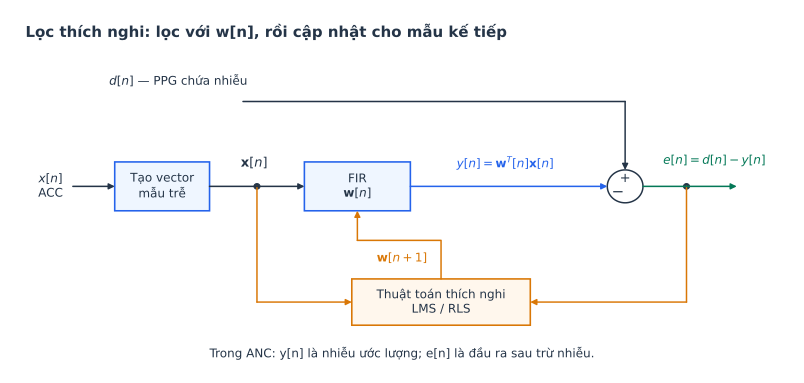

*Hình 1. Nhánh lọc tạo nhiễu ước lượng $y[n]$; phép trừ tạo đầu ra $e[n]$. Thuật toán dùng vector tham chiếu và sai số để cập nhật trọng số cho mẫu tiếp theo.*

## 2. Tín hiệu ngẫu nhiên và tương quan (Slide 9–13)

### Kỳ vọng (Mean)

$$
\mu = E[x[n]]
$$

### Tự tương quan (Autocorrelation)

Với tín hiệu thực dừng theo nghĩa rộng:

$$
r_{xx}[k] = E[x[n]x[n-k]]
$$

Đo mức độ tương quan giữa tín hiệu và bản dịch thời gian của chính nó.

### Tương quan chéo (Cross-correlation)

$$
r_{xd}[k] = E[x[n-k]d[n]]
$$

Đo mức độ liên hệ giữa hai tín hiệu.

### Ma trận tương quan

$$
\mathbf{R}_{xx}
=E[\mathbf{x}[n]\mathbf{x}^T[n]]
$$

Trong đó:

$$
\mathbf{x}[n]=
[x[n],x[n-1],\ldots,x[n-M+1]]^T
$$

Các tính chất:

- Đối xứng với tín hiệu thực.
- Có cấu trúc Toeplitz nếu tín hiệu dừng theo nghĩa rộng.
- Nửa xác định dương.
- Có thể không khả nghịch nếu dữ liệu thiếu thông tin độc lập.

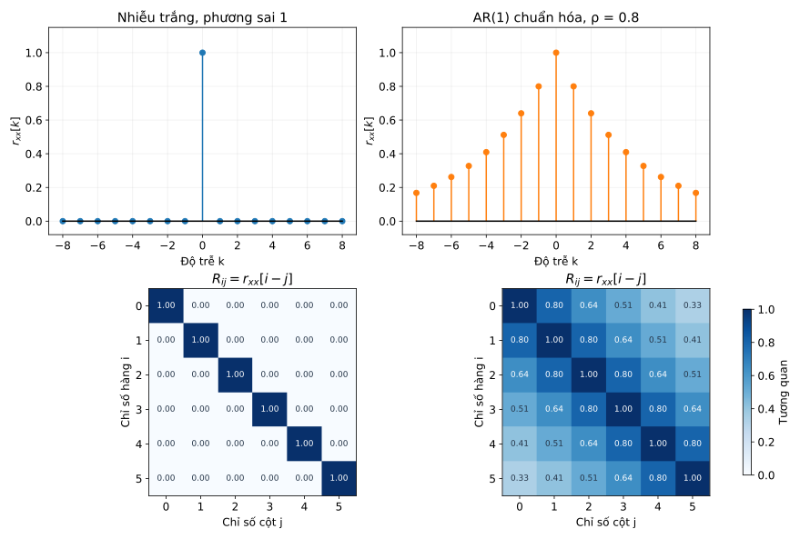

*Hình 2. Ví dụ lý thuyết với kỳ vọng 0, phương sai 1: nhiễu trắng có $r_{xx}[k]=\delta[k]$ và $R=I$; AR(1) chuẩn hóa có $r_{xx}[k]=0{,}8^{|k|}$. Các đường chéo song song của mỗi ma trận có cùng giá trị, minh họa tính Toeplitz.*

### Tính dừng

**Dừng theo nghĩa rộng (WSS):**

- Kỳ vọng không đổi theo thời gian.
- Tự tương quan chỉ phụ thuộc độ trễ k.

**Liên hệ:** Nhiễu chuyển động có thể thay đổi theo thời gian, là một động lực sử dụng lọc thích nghi thay vì chỉ dùng bộ lọc cố định.

## 3. Các mô hình tín hiệu AR, MA, ARMA (Slide 14–20)

### AR — Autoregressive

Giá trị hiện tại phụ thuộc các giá trị quá khứ của chính tín hiệu và một thành phần kích thích:

$$
u[n]=-\sum_{k=1}^{M}a_ku[n-k]+v[n]
$$

- Tương ứng mô hình all-pole.
- Có hồi tiếp.

### MA — Moving Average

$$
u[n]=v[n]+\sum_{k=1}^{K}b_kv[n-k]
$$

- Tương ứng mô hình all-zero.
- Có dạng FIR theo tín hiệu kích thích.

### ARMA

Kết hợp thành phần AR và MA:

$$
u[n]+\sum_{k=1}^{M}a_ku[n-k]
=v[n]+\sum_{k=1}^{K}b_kv[n-k]
$$

### Yule–Walker

Dùng hàm tự tương quan để tìm hệ số mô hình AR:

$$
\mathbf{R}\mathbf{w}=\mathbf{r}
$$

Nếu R khả nghịch:

$$
\mathbf{w}=\mathbf{R}^{-1}\mathbf{r}
$$

**Ghi nhớ:** AR, MA, ARMA là các mô hình tín hiệu ngẫu nhiên; không phải ba thuật toán khử nhiễu được sử dụng trong CPC.

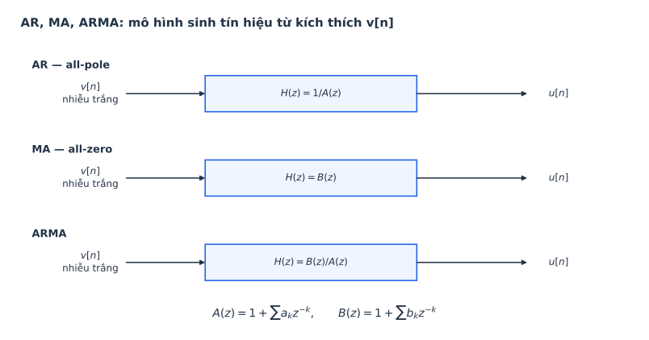

*Hình 3. Cùng cách nhìn “kích thích → hệ LTI → tín hiệu”: AR dùng mẫu số $A(z)$, MA dùng tử số $B(z)$, ARMA kết hợp cả hai.*

## 4. Mật độ phổ công suất — PSD (Slide 21–22)

PSD (Power Spectral Density) mô tả sự phân bố công suất tín hiệu theo tần số.

Quan hệ Wiener–Khinchin:

$$
S_{xx}(\omega)=
\sum_{k=-\infty}^{\infty}
r_{xx}[k]e^{-j\omega k}
$$

Nghĩa là PSD là biến đổi Fourier của hàm tự tương quan.

Khi tín hiệu dừng đi qua hệ LTI ổn định:

$$
S_{yy}(\omega)=
S_{xx}(\omega)|H(e^{j\omega})|^2
$$

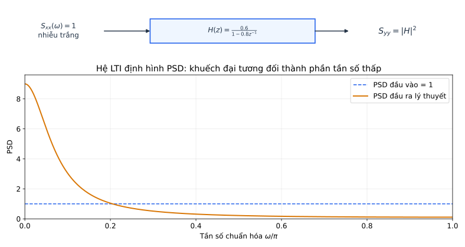

*Hình 4. Ví dụ $H(z)=0{,}6/(1-0{,}8z^{-1})$: PSD đầu vào phẳng, còn PSD đầu ra có công suất tập trung tương đối ở tần số thấp. Đây là PSD lý thuyết, không phải periodogram từ một đoạn đo hữu hạn.*

**Liên hệ CPC:**

- Sau lọc thích nghi, đồ án tính periodogram để tìm đỉnh phổ nhịp tim.
- Không đồng nhất periodogram của một đoạn hữu hạn với PSD lý thuyết chính xác của quá trình ngẫu nhiên.

## 5. Bộ lọc Wiener — Trọng tâm (Slide 24–30)

**Mục tiêu:** Tìm vector trọng số tối ưu sao cho sai số bình phương trung bình (MSE) nhỏ nhất.

$$
J(\mathbf{w})=E[e^2[n]]
$$

Với:

$$
e[n]=d[n]-\mathbf{w}^T\mathbf{x}[n]
$$

Khai triển hàm chi phí:

$$
J(\mathbf{w})
=\sigma_d^2
-2\mathbf{w}^T\mathbf{r}_{xd}
+\mathbf{w}^T\mathbf{R}_{xx}\mathbf{w}
$$

Gradient:

$$
\nabla J
=-2\mathbf{r}_{xd}
+2\mathbf{R}_{xx}\mathbf{w}
$$

Để đạt cực tiểu:

$$
\nabla J=0
$$

Suy ra phương trình **Wiener–Hopf**:

$$
\boxed{
\mathbf{R}_{xx}\mathbf{w}_{opt}
=\mathbf{r}_{xd}
}
$$

Nếu ma trận khả nghịch:

$$
\boxed{
\mathbf{w}_{opt}
=\mathbf{R}_{xx}^{-1}\mathbf{r}_{xd}
}
$$

### Nguyên lý trực giao

Ở nghiệm tối ưu:

$$
E[\mathbf{x}[n]e_{opt}[n]]=0
$$

**Ý nghĩa:** Sai số tối ưu không còn tương quan tuyến tính với các mẫu tham chiếu được dùng để dự đoán.

**Hạn chế:** Nghiệm Wiener cần biết hoặc ước lượng các thống kê tương quan.

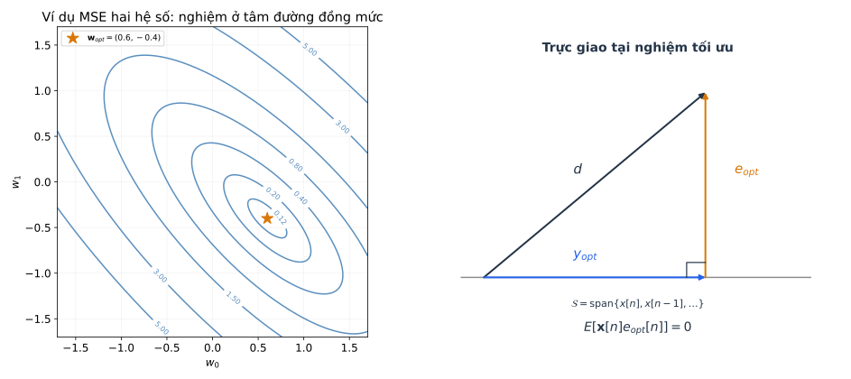

*Hình 5. Trái: ví dụ hai hệ số có nghiệm $\mathbf{w}_{opt}=(0{,}6;-0{,}4)$ và $J_{min}=0{,}1$. Phải: hình học khái niệm trong không gian tín hiệu với tích vô hướng $E[ab]$; sai số tối ưu trực giao với không gian tham chiếu. Điều này không có nghĩa $x[n]e_{opt}[n]=0$ ở từng mẫu.*

## 6. Dự đoán tuyến tính (Slide 32–35)

**Forward Linear Prediction (FLP):**

- Sử dụng các mẫu quá khứ để dự đoán mẫu hiện tại.

$$
\hat{x}[n]
=\sum_{k=1}^{M}w_kx[n-k]
$$

**Backward Linear Prediction (BLP):**

- Sử dụng các mẫu hiện tại/gần hiện tại để dự đoán một mẫu quá khứ.

Mục tiêu là tối thiểu hóa sai số dự đoán theo MSE.

**Ghi nhớ:** Bài toán dự đoán tuyến tính có thể xây dựng phương trình Wiener–Hopf và giải bằng phương pháp thích hợp như Levinson–Durbin.

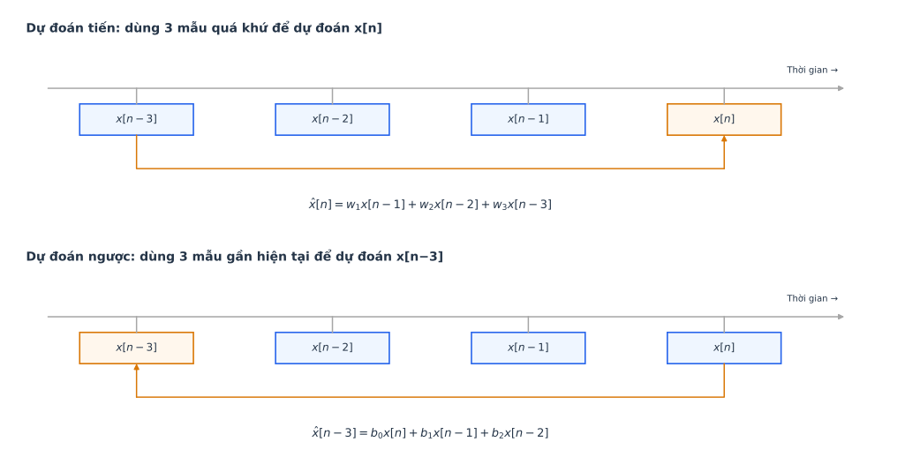

*Hình 6. Ví dụ $M=3$: các ô xanh là tập mẫu dùng để dự đoán, ô cam là mẫu cần dự đoán; mũi tên cam chỉ hướng suy đoán. Tại thời điểm $n$, dự đoán ngược vẫn chỉ sử dụng các mẫu đã có.*

## 7. Steepest Descent — Trọng tâm (Slide 37–40)

Thay vì giải trực tiếp nghiệm Wiener, thuật toán Steepest Descent cập nhật trọng số theo hướng ngược gradient của hàm chi phí.

Theo quy ước trong slide:

$$
\mathbf{w}[n+1]
=\mathbf{w}[n]-\frac{\mu}{2}\nabla J
$$

Thay gradient Wiener:

$$
\boxed{
\mathbf{w}[n+1]
=\mathbf{w}[n]
+\mu(\mathbf{r}_{xd}
-\mathbf{R}_{xx}\mathbf{w}[n])
}
$$

Trong đó:

- `mu`: bước học (step size).
- `Rxx`: ma trận tương quan đầu vào.
- `rxd`: vector tương quan chéo.

**Điều kiện hội tụ theo slide:**

$$
0<\mu<\frac{2}{\lambda_{max}}
$$

Với `lambda_max` là trị riêng lớn nhất của ma trận tương quan đầu vào.

**Vai trò của mu:**

- Quá nhỏ: cập nhật chậm.
- Quá lớn: có thể dao động hoặc mất ổn định.

Điều kiện trên áp dụng cho Steepest Descent trên hàm chi phí bậc hai; không phải bảo đảm hội tụ tuyệt đối cho mọi LMS dùng gradient tức thời.

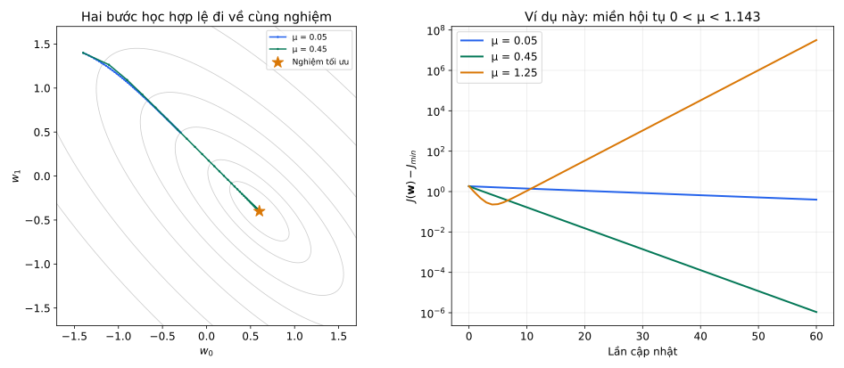

*Hình 7. Ví dụ $R=\begin{bmatrix}1&0{,}75\\0{,}75&1\end{bmatrix}$ có $\lambda_{max}=1{,}75$: $\mu=0{,}05$ hội tụ chậm, $\mu=0{,}45$ nhanh hơn; $\mu=1{,}25$ vượt ngưỡng $2/\lambda_{max}$ nên phân kỳ. Đồ thị phải dùng thang log cho phần MSE vượt mức tối thiểu.*

## 8. LMS — Kiến thức bổ sung từ đồ án

**LMS (Least Mean Squares)** là thuật toán thích nghi dùng ước lượng gradient tức thời thay cho gradient kỳ vọng.

Với tín hiệu thực:

$$
y[n]=\mathbf{w}^T[n]\mathbf{x}[n]
$$

$$
e[n]=d[n]-y[n]
$$

**Cập nhật LMS:**

$$
\boxed{
\mathbf{w}[n+1]
=\mathbf{w}[n]
+\mu e[n]\mathbf{x}[n]
}
$$

**Đặc điểm:**

- Đơn giản, dễ triển khai.
- Độ phức tạp cơ bản O(M) mỗi mẫu.
- Chịu ảnh hưởng bởi bước học và tương quan đầu vào.
- Có thể cần nhiều mẫu để hội tụ.

**Cấu hình CPC:**

- `mu = 0.0001`
- `M = 27` hệ số FIR mỗi tầng.

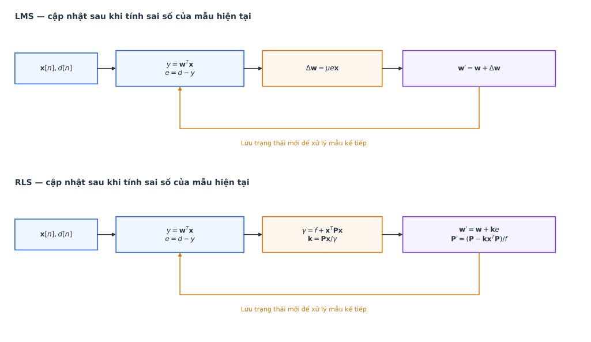

*Hình 8. LMS cập nhật bằng $\mu e\mathbf{x}$; RLS tính gain $\mathbf{k}$ từ $\mathbf{P}$ rồi cập nhật cả trọng số và ma trận. Dấu phẩy trên $\mathbf{w}^{\prime},\mathbf{P}^{\prime}$ chỉ trạng thái sau cập nhật; $y,e$ dùng trọng số trước cập nhật.*

## 9. RLS — Kiến thức bổ sung từ đồ án

**RLS (Recursive Least Squares)** sử dụng bình phương tối thiểu có trọng số theo thời gian và cập nhật nghiệm đệ quy.

Ý tưởng:

- Sử dụng thông tin từ các quan sát trước.
- Điều chỉnh ảnh hưởng của các quan sát cũ bằng forgetting factor.
- Cập nhật vector trọng số và ma trận phụ trợ.

### Công thức RLS trong bản tái hiện

Với P là ma trận phụ trợ:

$$
\mathbf{k}[n]=
\frac{\mathbf{P}[n]\mathbf{x}[n]}
{f+\mathbf{x}^T[n]\mathbf{P}[n]\mathbf{x}[n]}
$$

$$
e[n]=d[n]-\mathbf{w}^T[n]\mathbf{x}[n]
$$

$$
\boxed{
\mathbf{w}[n+1]
=\mathbf{w}[n]+\mathbf{k}[n]e[n]
}
$$

Cập nhật ma trận:

$$
\mathbf{P}[n+1]
=\frac{1}{f}
\left[
\mathbf{P}[n]
-\mathbf{k}[n]\mathbf{x}^T[n]\mathbf{P}[n]
\right]
$$

Trong đó:

- `k[n]`: vector gain.
- `f`: forgetting factor.
- `P[n]`: ma trận phụ trợ liên quan nghịch đảo ma trận tương quan có trọng số.

**Cấu hình CPC:**

- `M = 55` hệ số FIR mỗi tầng.
- `f = 0.999`: cách diễn giải tham số trong bản tái hiện.
- `P[0] = I`: lựa chọn khởi tạo của project.

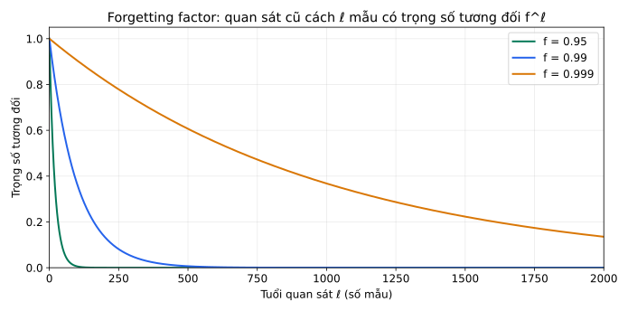

*Hình 9. Trong bình phương tối thiểu có trọng số, quan sát cũ cách $\ell$ mẫu được nhân với $f^{\ell}$: $f$ càng gần 1 thì quên càng chậm. Hình minh họa một lần chạy liên tục; CPC của đồ án khởi tạo lại trạng thái RLS ở mỗi cửa sổ.*

**Đặc điểm:**

- Có cơ chế cập nhật sử dụng thông tin tương quan của các quan sát.
- Độ phức tạp cơ bản O(M²) mỗi mẫu.
- Tốn tính toán và bộ nhớ hơn LMS với cùng số hệ số.
- Có thể thích nghi nhanh hơn LMS trong nhiều điều kiện, nhưng không bảo đảm tốt hơn trong mọi bài toán.

## 10. So sánh LMS và RLS

| Tiêu chí         | LMS                 | RLS                    |
| ------------------ | ------------------- | ---------------------- |
| Nguyên lý        | Gradient tức thời | Least Squares đệ quy |
| Cập nhật         | Vector trọng số   | Vector + ma trận      |
| Tham số chính    | Step size mu        | Forgetting factor f    |
| Chi phí mỗi mẫu | O(M)                | O(M²)                 |
| Bộ nhớ           | O(M)                | O(M²)                 |
| Cấu hình CPC     | 27 hệ số          | 55 hệ số             |
| AAE tái hiện     | 11.8987 BPM         | 2.6482 BPM             |

**Lưu ý:** Các AAE trên là kết quả riêng của đồ án, không phải khẳng định RLS luôn tốt hơn LMS.

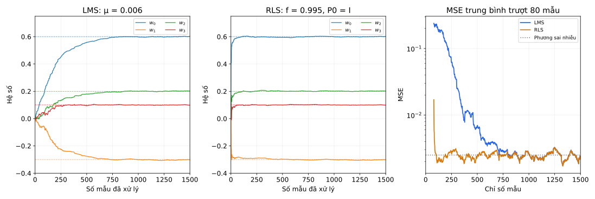

*Hình 10. Ví dụ nhận dạng hệ thống tổng hợp chạy bằng các hàm LMS/RLS của project: cả hai dùng 4 hệ số và cùng dữ liệu. Nét đứt là hệ số thật; RLS tiến gần chúng nhanh hơn trong ví dụ này. Các tham số trên hình phục vụ minh họa, không phải cấu hình CPC 27/55 hệ số hay kết quả đo PPG.*

---

## 11. CPC trong đồ án — Thiết kế, ký hiệu và tham số

### 11.1. Nhìn toàn bộ luồng xử lý

**CPC = Cascade and Parallel Combination:** nối tiếp ba tầng ANC trong mỗi nhánh, chạy song song hai nhánh LMS/RLS rồi kết hợp đầu ra.

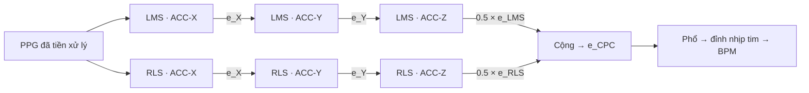

Hai nhánh nhận **cùng PPG và ACC đã tiền xử lý**. Mỗi tầng học một bộ hệ số riêng; đầu ra $e_X,e_Y$ trở thành đầu vào chính của tầng sau. ACC cần tương quan với nhiễu chuyển động và ít tương quan với nhịp tim để hạn chế trừ mất tín hiệu cần giữ.

### 11.2. Ký hiệu tại một tầng ANC

| Ký hiệu                             | Nghĩa trong CPC                                                                                                     |
| ------------------------------------- | -------------------------------------------------------------------------------------------------------------------- |
| $n$, $M$                          | Chỉ số mẫu trong cửa sổ; số hệ số FIR của **mỗi tầng**.                                             |
| $d[n]$                              | Đầu vào chính: PPG nhiễu ở tầng X; tín hiệu dư của tầng trước ở tầng Y/Z.                            |
| $x[n]$, $\mathbf{x}[n]$           | Một trục ACC; vector $[x[n],\ldots,x[n-M+1]]^T$ gồm hiện tại và quá khứ.                                   |
| $\mathbf{w}[n]$                     | $M$ hệ số học quan hệ ACC → nhiễu PPG; $T$ là phép chuyển vị.                                          |
| $y[n]=\mathbf{w}^T[n]\mathbf{x}[n]$ | Nhiễu ước lượng để trừ khỏi $d[n]$.                                                                       |
| $e[n]=d[n]-y[n]$                    | Tín hiệu sau trừ nhiễu, vừa làm đầu ra vừa dẫn động cập nhật.                                          |
| $\mathbf{P}[n]$, $\mathbf{k}[n]$  | Ma trận nghịch đảo tương quan có trọng số và vector độ lợi RLS; được cập nhật/tính từ dữ liệu. |

**Một mẫu:** lấy vector ACC → tính $y[n]$ → trừ được $e[n]$ → cập nhật hệ số cho mẫu kế tiếp. LMS dùng $\Delta\mathbf{w}=\mu e[n]\mathbf{x}[n]$; RLS dùng $\Delta\mathbf{w}=\mathbf{k}[n]e[n]$ (công thức đầy đủ ở mục 9).

**Mục tiêu tối ưu** là giảm sai số bình phương: LMS dùng gradient tức thời của MSE; RLS dùng tổng bình phương có trọng số. $e[n]$ là tín hiệu dư, không phải bản thân hàm mục tiêu; trong ANC ta muốn giữ nhịp tim trong $e[n]$, không ép nó về 0.

### 11.3. Tham số thực sự được dùng

| Tham số / cấu hình                           | Giá trị trong code                               | Ý nghĩa và đánh đổi                                                                                                                                                |
| ----------------------------------------------- | -------------------------------------------------- | ------------------------------------------------------------------------------------------------------------------------------------------------------------------------- |
| Số hệ số $M$                               | LMS: **27**; RLS: **55**, mỗi tầng   | Nhiều hệ số cho phép mô hình hóa quan hệ có độ trễ phức tạp hơn, nhưng tăng chi phí và số hệ số phải học; không bảo đảm tốt hơn.            |
| Bước học LMS $\mu$                         | **0.0001**                                   | Nhỏ → sửa ít, thường chậm hơn; lớn → nhanh hơn nhưng dễ dao động. Mức cập nhật còn phụ thuộc biên độ ACC và sai số.                             |
| Hệ số quên RLS $f$                         | **0.999**                                    | Mẫu cũ cách $\ell$ bước có trọng số $f^\ell$. Gần 1 → nhớ lâu; giảm $f$ → bám thay đổi nhanh hơn nhưng nhạy dao động hơn.                    |
| Khởi tạo RLS $P_0=\alpha I_{55}$            | $\alpha=$ **1.0**                          | Ma trận $55\times55$ quyết định độ lợi ban đầu; $I_{55}$ là ma trận đơn vị. Nếu viết $P_0=\delta^{-1}I$, ở đây $\delta=1$.                     |
| Trạng thái ban đầu                          | $\mathbf{w}_0=\mathbf{0}$; lịch sử ACC bằng 0 | **Khởi tạo lại từng tầng, từng cửa sổ**; không truyền trạng thái thích nghi sang cửa sổ sau.                                                         |
| Trọng số kết hợp $\lambda_{\mathrm{CPC}}$ | **0.5**                                      | $e_{\mathrm{CPC}}=\lambda_{\mathrm{CPC}}e_{\mathrm{LMS}}+(1-\lambda_{\mathrm{CPC}})e_{\mathrm{RLS}}$: phối hợp đều hai nhánh. Đây là tham số khác với $f$. |

**Cách đọc cấu hình:** $M$ quyết định số hệ số cần học; $\mu$ quyết định bước sửa LMS; $f$ quyết định mức nhớ RLS; $P_0$ đặt trạng thái thông tin ban đầu; $\lambda_{\mathrm{CPC}}$ quyết định tỷ lệ trộn hai đầu ra.

### 11.4. Đặt bộ lọc vào quy trình ước lượng BPM

| Công đoạn            | Thiết kế của đồ án                                                                                                                                                                                                                     |
| ----------------------- | -------------------------------------------------------------------------------------------------------------------------------------------------------------------------------------------------------------------------------------------- |
| Chuẩn bị dữ liệu    | $F_s=125$ Hz; cửa sổ **8 s = 1.000 mẫu**, dịch **2 s = 250 mẫu**. Lọc từng kênh trong dải **0.4–3.5 Hz**, rồi lấy trung bình hai kênh PPG.                                                                 |
| Khử nhiễu             | Chạy sáu tầng ANC như sơ đồ; ba tầng LMS dùng 27 hệ số/tầng, ba tầng RLS dùng 55 hệ số/tầng.                                                                                                                                |
| Ước lượng nhịp tim | Đệm 0 lên **FFT 4.096 điểm**, chọn đỉnh trong dải nhịp tim; cửa sổ sau tìm quanh đỉnh trước **±10 bin**. $\mathrm{BPM}=60f_{\mathrm{peak}}$, với $f_{\mathrm{peak}}$ là tần số đỉnh, tính bằng Hz. |
| Làm trơn BPM          | Trọng số **0.90 / 0.05 / 0.05** cho BPM thô hiện tại / trước một / trước hai cửa sổ; giữ nguyên hai cửa sổ đầu.                                                                                                      |

**Quy ước tái dựng:** code hiểu 27/55 là *số hệ số* (bậc FIR thông thường là 26/54). Cách hiểu 0.999 là hệ số quên, $P_0=I$, khởi tạo 0 và reset theo cửa sổ là các lựa chọn tái dựng; không khẳng định đều đã được bài báo mô tả đầy đủ. Nhãn BPM tham chiếu dùng để đánh giá, không dùng cập nhật các bộ lọc.

**Đối chiếu code:** [tham số LMS/RLS](../../../src/cpc_ppg/adaptive_filters/config.py), [ba tầng ANC và reset](../../../src/cpc_ppg/adaptive_filters/cascade.py), [kết hợp CPC](../../../src/cpc_ppg/adaptive_filters/cpc.py), [tiền xử lý](../../../src/cpc_ppg/preprocessing/config.py), [ước lượng BPM](../../../src/cpc_ppg/hr/config.py).

---

## 12. Luồng dữ liệu CPC — Phần trình bày chính khi báo cáo

**Ý chính:** ACC cho biết chuyển động; các bộ lọc học cách biến ACC thành nhiễu PPG ước lượng. Mỗi tầng trừ phần nhiễu học được, hai nhánh kết hợp tín hiệu còn lại, rồi mới ước lượng BPM.

### 12.1. Sơ đồ từ dữ liệu đo đến kết quả

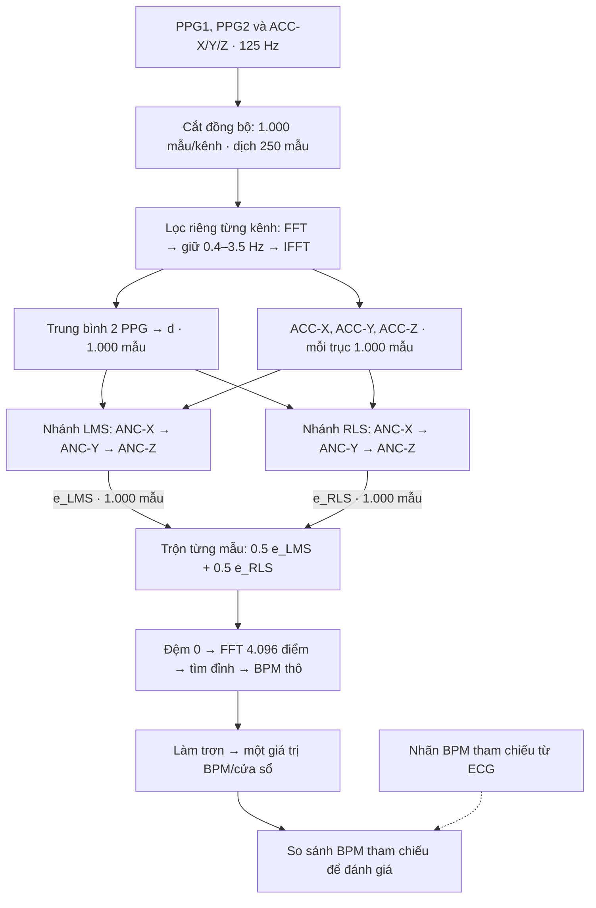

**Ba cấp dữ liệu cần phân biệt:** mẫu tín hiệu → cửa sổ 8 giây → chuỗi BPM theo thời gian. Ký hiệu $n=0,\ldots,999$ chỉ mẫu trong một cửa sổ; $m=0,1,\ldots$ chỉ cửa sổ của bản ghi.

### 12.2. Cắt cửa sổ và tiền xử lý: tạo đầu vào cho ANC

Tại $F_s=125$ Hz, mỗi cửa sổ chứa **1.000 mẫu = 8 giây** trên cả năm kênh. Các kênh được cắt cùng vị trí để giữ đồng bộ:

| Cửa sổ $m$ | Khoảng mẫu, gồm đầu và không gồm cuối | Khoảng thời gian |
| -------------- | ---------------------------------------------- | ------------------ |
| 0              | $[0,1000)$                                   | $[0,8)$ s        |
| 1              | $[250,1250)$                                 | $[2,10)$ s       |
| 2              | $[500,1500)$                                 | $[4,12)$ s       |

Cửa sổ dịch 250 mẫu nên hai cửa sổ kề nhau chồng **750 mẫu = 6 giây**. Đoạn cuối không đủ 1.000 mẫu không được tạo thành cửa sổ.

Trong **từng cửa sổ**, lọc riêng PPG1, PPG2 và ba trục ACC bằng FFT 1.000 điểm: đưa các bin ngoài dải 0.4–3.5 Hz về 0 rồi IFFT. Sau đó mới lấy trung bình hai PPG đã lọc:

$$
d[n]=\frac{\mathrm{PPG}_{1,f}[n]+\mathrm{PPG}_{2,f}[n]}{2}.
$$

Ký hiệu $f$ ở chỉ số dưới biểu thị tín hiệu **đã lọc**, không phải hệ số quên RLS. Đầu ra tiền xử lý là **bốn chuỗi 1.000 mẫu**: $d[n]$ và $x_X[n],x_Y[n],x_Z[n]$. Hai nhánh LMS/RLS nhận cùng bốn chuỗi này.

**Vì sao vẫn cần ANC?** Lọc dải loại thành phần ngoài dải, nhưng nhiễu chuyển động có thể nằm ngay trong dải nhịp tim. ANC khai thác thêm thông tin ACC để ước lượng phần nhiễu đó. Việc xử lý ở đây theo khối 8 giây; không đồng nghĩa toàn bộ pipeline chạy tức thời từng mẫu.

### 12.3. Bên trong một tầng ANC: lọc trước, cập nhật sau

**ANC (Adaptive Noise Cancellation) là cấu trúc khử nhiễu; LMS/RLS là thuật toán học hệ số bên trong cấu trúc đó.** Ở một tầng, gọi ACC tham chiếu là $x[n]$ và tín hiệu cần khử nhiễu là $d[n]$.

| Bước tại mẫu $n$           | Tính toán                                                                            | Ý nghĩa                                                                                   |
| -------------------------------- | -------------------------------------------------------------------------------------- | ------------------------------------------------------------------------------------------- |
| 1. Gom mẫu ACC                  | $\mathbf{x}[n]=[x[n],x[n-1],\ldots,x[n-M+1]]^T$                                      | Tạo vector $M$ mẫu hiện tại/quá khứ; đầu cửa sổ thiếu lịch sử thì điền 0. |
| 2. Lọc bằng hệ số hiện tại | $y[n]=\mathbf{w}^T[n]\mathbf{x}[n]$                                                  | Tạo **một mẫu nhiễu ước lượng** từ ACC.                                      |
| 3. Trừ khỏi đầu vào chính  | $e[n]=d[n]-y[n]$                                                                     | Tạo **một mẫu tín hiệu dư** để giữ lại.                                     |
| 4. Học từ sai số              | LMS hoặc RLS cập nhật $\mathbf{w}[n+1]$; RLS cập nhật thêm $\mathbf{P}[n+1]$ | Trạng thái mới dùng cho mẫu tiếp theo, không tính lại $y[n]$ vừa xuất.         |

Phép nhân vector ở bước 2 là tổng có trọng số:

$$
y[n]=\sum_{k=0}^{M-1}w_k[n]x[n-k].
$$

Đây là dạng tính đầu ra FIR. Nếu giữ cố định các hệ số, nó là tích chập với đáp ứng xung $h[k]=w_k$. Trong LMS/RLS, hệ số thay đổi theo $n$ nên không có một đáp ứng xung cố định cho toàn bộ quá trình. Chỉ số $k$ biểu diễn **độ trễ**, còn $n$ biểu diễn **thời điểm cập nhật**.

Trong ANC, $d[n]$ là đầu vào chính chứa tín hiệu cần giữ và nhiễu, **không phải PPG sạch có sẵn để huấn luyện**. Bộ lọc dựa vào tương quan ACC–nhiễu: nếu $y[n]$ gần với nhiễu thì $e[n]$ gần với PPG sạch. Sai số bình phương là đại lượng tối ưu; không kỳ vọng $e[n]=0$ vì nhịp tim vẫn cần nằm trong tín hiệu dư.

### 12.4. LMS và RLS thay đổi bước học hệ số như thế nào?

Hai thuật toán dùng chung các bước tạo vector, tính $y[n]$ và lấy $e[n]$. Khác biệt nằm ở **bước cập nhật**:

|                           | Một tầng LMS                                                           | Một tầng RLS                                                                                                                     |
| ------------------------- | ------------------------------------------------------------------------ | ---------------------------------------------------------------------------------------------------------------------------------- |
| Bộ nhớ ACC tức thời   | $M=27$ mẫu, từ $x[n]$ đến $x[n-26]$                            | $M=55$ mẫu, từ $x[n]$ đến $x[n-54]$                                                                                      |
| Trạng thái học         | Vector $\mathbf{w}$ có 27 hệ số                                     | Vector $\mathbf{w}$ có 55 hệ số và ma trận $\mathbf{P}$ kích thước $55\times55$                                      |
| Cập nhật trọng số     | $\mathbf{w}[n+1]=\mathbf{w}[n]+0.0001\,e[n]\mathbf{x}[n]$              | Tính gain $\mathbf{k}[n]$ từ $\mathbf{P}[n],\mathbf{x}[n],f=0.999$; rồi $\mathbf{w}[n+1]=\mathbf{w}[n]+\mathbf{k}[n]e[n]$ |
| Cách dùng dữ liệu cũ | Ảnh hưởng được giữ gián tiếp trong các hệ số đã cập nhật | Tích lũy thông tin tương quan trong $\mathbf{P}$; trọng số quan sát cũ suy giảm theo $f^\ell$                        |

Công thức gain và cập nhật $\mathbf{P}$ ở mục 9. **27/55 là số hệ số mỗi tầng, không phải số vòng lặp:** mỗi tầng vẫn xử lý đủ 1.000 mẫu. Vector ACC chỉ chứa 27/55 mẫu gần nhất, nhưng trạng thái đã học còn mang ảnh hưởng từ các mẫu trước đó trong cửa sổ.

**Ví dụ một bước để giải thích bằng lời** — chỉ minh họa, không phải cấu hình hay số liệu thực nghiệm của đồ án: với $M=3$, $\mathbf{w}=[0.5,0.3,0.2]^T$, $\mathbf{x}=[2,1,0]^T$ và $d=3$:

$$
y=0.5\times2+0.3\times1+0.2\times0=1.3,
\qquad e=3-1.3=1.7.
$$

Nếu dùng LMS với $\mu=0.0001$, bộ hệ số mới là $[0.50034,0.30017,0.2]^T$. **Đầu ra mẫu hiện tại vẫn là $e=1.7$**; hệ số mới dành cho mẫu kế tiếp. Đây là quá trình “ước lượng nhiễu → trừ → học lại”.

### 12.5. Ba tầng nối tiếp: tín hiệu nào được chuyển sang tầng sau?

Gọi $b\in\{L,R\}$ là nhánh LMS/RLS, $a\in\{X,Y,Z\}$ là trục ACC. Mỗi tầng có bộ hệ số riêng $\mathbf{w}_{b,a}$ và tạo nhiễu ước lượng $y_{b,a}$:

| Tầng trong nhánh $b$ | Đầu vào chính          | ACC tham chiếu | Đầu ra chuyển tiếp      |
| ------------------------ | -------------------------- | --------------- | --------------------------- |
| X                        | PPG tiền xử lý $d$    | ACC-X           | $e_{b,X}=d-y_{b,X}$       |
| Y                        | Tín hiệu dư $e_{b,X}$ | ACC-Y           | $e_{b,Y}=e_{b,X}-y_{b,Y}$ |
| Z                        | Tín hiệu dư $e_{b,Y}$ | ACC-Z           | $e_{b,Z}=e_{b,Y}-y_{b,Z}$ |

Mỗi ô tín hiệu trong bảng là **cả chuỗi 1.000 mẫu**. Trong code, một tầng xử lý xong cửa sổ mới chuyển chuỗi sai số sang tầng kế tiếp. Sau tầng Z:

$$
e_{\mathrm{LMS}}=e_{L,Z},\qquad
e_{\mathrm{RLS}}=e_{R,Z}.
$$

**Điểm phải nói rõ khi chỉ sơ đồ:** chuyển $e$, tức PPG còn lại sau phép trừ, sang tầng sau. $y$ là nhiễu ước lượng của tầng hiện tại. Không lấy ACC-X làm đầu vào chính của tầng Y, không truyền bộ hệ số tầng X sang tầng Y, và không nối đầu ra LMS sang RLS.

Ba tầng xử lý lần lượt phần nhiễu còn liên hệ với từng trục; không giả định nhiễu chia thành ba phần độc lập hay mỗi tầng luôn làm kết quả tốt hơn. Hai nhánh là song song **về kiến trúc**; mã hiện tại gọi nhánh LMS rồi nhánh RLS trên cùng dữ liệu.

### 12.6. Kết hợp hai nhánh: trộn tín hiệu trước khi tìm BPM

Hai chuỗi đầu ra cùng cửa sổ và cùng vị trí mẫu được kết hợp:

$$
e_{\mathrm{CPC}}[n]
=0.5e_{\mathrm{LMS}}[n]+0.5e_{\mathrm{RLS}}[n],
\qquad n=0,\ldots,999.
$$

Sau phép trộn vẫn là **một chuỗi 1.000 mẫu**, chưa phải BPM. Ví dụ tại một vị trí mẫu, hai nhánh cho 1.2 và 0.8 thì CPC cho 1.0. Đây là trung bình **biên độ tín hiệu từng mẫu**, không phải lấy trung bình hai giá trị BPM hoặc hai bộ hệ số.

Trọng số $\lambda_{\mathrm{CPC}}=0.5$ được giữ cố định trong cấu hình chính; không có bước học trọng số trộn từ nhãn. Hai nhánh có thể tạo phần nhiễu dư khác nhau, nhưng hiệu quả kết hợp phải được kiểm tra bằng kết quả thực nghiệm.

### 12.7. Từ chuỗi CPC đến một giá trị BPM

**Bước 1 — Tạo phổ:** đệm thêm 3.096 số 0 vào chuỗi CPC 1.000 mẫu để tính FFT 4.096 điểm; lấy bình phương biên độ phổ làm đại lượng tìm đỉnh. Không kéo dài thời gian đo thực tế.

**Bước 2 — Chọn đỉnh:** cửa sổ đầu chọn đỉnh lớn nhất trong 0.4–3.5 Hz. Từ cửa sổ sau, chỉ tìm trong vùng **±10 bin quanh bin đã chọn ở cửa sổ trước**, đồng thời vẫn nằm trong dải trên. Bộ theo dõi dùng bin đỉnh trước đó, không dùng BPM tham chiếu hay BPM đã làm trơn.

**Bước 3 — Đổi sang BPM:** với bin $k_m$ đánh số từ 0 và $B_m$ là BPM thô của cửa sổ $m$:

$$
f_{\mathrm{peak},m}=\frac{k_mF_s}{4096},
\qquad
B_m=60\frac{k_mF_s}{4096}.
$$

Ví dụ $k_m=49$ cho khoảng **89.722 BPM**. Bước lưới BPM là $60\times125/4096\approx1.831$ BPM/bin, nhỏ hơn 7.5 BPM/bin khi FFT 1.000 điểm: có thể giảm sai số rời rạc hóa khi chọn đỉnh, nhưng không thêm thông tin đo hoặc bảo đảm giảm mọi loại sai số.

**Bước 4 — Làm trơn:** từ cửa sổ thứ ba, tính

$$
\widehat{B}_m=0.90B_m+0.05B_{m-1}+0.05B_{m-2}.
$$

Hai cửa sổ đầu giữ nguyên. Các giá trị bên phải đều là **BPM thô**, không hồi tiếp BPM đã làm trơn. Kết quả chính là một BPM mỗi cửa sổ, tức cập nhật theo bước 2 giây. Chế độ hiệu chỉnh offline bổ sung không được bật trong cấu hình mặc định.

**Phân biệt hai lần FFT:** FFT **1.000 điểm + IFFT** ở đầu để lọc dải từng kênh; FFT **4.096 điểm** ở cuối để tìm tần số nhịp tim từ đầu ra CPC.

### 12.8. Cái gì được nhớ khi chuyển cửa sổ?

| Thành phần                                  | Trong một cửa sổ                    | Sang cửa sổ kế tiếp                                                   |
| --------------------------------------------- | -------------------------------------- | ------------------------------------------------------------------------- |
| Hệ số LMS/RLS và lịch sử ACC từng tầng | Cập nhật liên tục qua 1.000 mẫu   | Khởi tạo lại bằng 0, dù hai cửa sổ có phần dữ liệu chồng nhau |
| Ma trận RLS $\mathbf{P}$ từng tầng       | Cập nhật theo từng mẫu             | Khởi tạo lại bằng $I_{55}$                                          |
| Theo dõi đỉnh phổ                         | Chọn một bin cho cửa sổ hiện tại | Giữ bin để giới hạn vùng tìm kiếm cửa sổ sau                    |
| Lịch sử BPM thô                            | Tạo một giá trị $B_m$            | Giữ hai giá trị gần nhất để làm trơn                             |

Khi bắt đầu **bản ghi mới**, cả theo dõi đỉnh và lịch sử BPM cũng được khởi tạo lại. Nhãn BPM từ ECG chỉ dùng so sánh với ước lượng để đánh giá; không đi vào phép lọc, cập nhật trọng số hay tìm đỉnh. Các quy ước tái dựng ở mục 11.4 vẫn áp dụng cho luồng này.

### 12.9. Lời dẫn ngắn khi chỉ vào sơ đồ

> “Đầu vào gồm hai kênh PPG và ba trục gia tốc được đo đồng bộ ở 125 Hz. Em chia dữ liệu thành cửa sổ 8 giây, dịch 2 giây; lọc dải từng kênh rồi lấy trung bình hai PPG.
>
> PPG này đi vào hai nhánh LMS và RLS. Mỗi nhánh có ba tầng ANC ứng với ACC-X, Y và Z. Trong một tầng, bộ lọc kết hợp các mẫu ACC hiện tại và quá khứ để tạo nhiễu ước lượng y. Em trừ y khỏi đầu vào chính để lấy tín hiệu dư e, rồi dùng e và ACC để cập nhật hệ số cho mẫu tiếp theo. LMS dùng bước học cố định; RLS tính độ lợi dựa trên thông tin tương quan đã tích lũy.
>
> Tín hiệu e của tầng trước đi vào tầng sau; mỗi tầng có bộ hệ số riêng. Sau tầng Z, em trộn hai chuỗi tín hiệu dư với trọng số 0.5 và 0.5. Sau đó mới tính phổ 4.096 điểm, theo dõi đỉnh và đổi tần số sang BPM, rồi làm trơn.
>
> Bộ lọc được khởi tạo lại mỗi cửa sổ; bộ theo dõi giữ đỉnh phổ trước đó trong cùng bản ghi. BPM tham chiếu từ ECG chỉ dùng đánh giá, không dùng để dạy bộ lọc.”

**Đường dẫn khi cần mở code minh họa:** [cắt cửa sổ](../../../src/cpc_ppg/data/segmentation.py) → [tiền xử lý](../../../src/cpc_ppg/preprocessing/pipeline.py) → [LMS](../../../src/cpc_ppg/adaptive_filters/lms.py) / [RLS](../../../src/cpc_ppg/adaptive_filters/rls.py) → [nối ba tầng](../../../src/cpc_ppg/adaptive_filters/cascade.py) → [trộn hai nhánh](../../../src/cpc_ppg/adaptive_filters/cpc.py) → [ước lượng BPM](../../../src/cpc_ppg/hr/pipeline.py).

---

## 13. Các câu hỏi phản biện quan trọng

### Câu 1. Bộ lọc thích nghi khác bộ lọc cố định thế nào?

Bộ lọc cố định giữ nguyên hệ số. Bộ lọc thích nghi cập nhật hệ số dựa trên dữ liệu và sai số để phản ứng với môi trường tín hiệu thay đổi.

### Câu 2. Tại sao CPC dùng ACC để khử nhiễu PPG?

ACC cung cấp thông tin về chuyển động, có thể tương quan với thành phần nhiễu chuyển động trong PPG. Bộ lọc thích nghi học quan hệ đó để ước lượng nhiễu.

### Câu 3. Vì sao đầu ra khử nhiễu là e[n]?

Vì y[n] là thành phần được ước lượng từ tham chiếu ACC. Khi trừ y[n] khỏi PPG nhiễu d[n], phần còn lại e[n] là tín hiệu sau khử nhiễu ước lượng.

### Câu 4. Wiener khác LMS thế nào?

Wiener tìm trọng số tối ưu MSE từ ma trận tương quan và tương quan chéo. LMS cập nhật trọng số lặp theo gradient tức thời, không cần biết trước các thống kê đó.

### Câu 5. Tại sao LMS cần bước học mu?

Mu điều chỉnh độ lớn mỗi lần cập nhật trọng số, ảnh hưởng đến tốc độ thích nghi và khả năng ổn định.

### Câu 6. RLS khác LMS ở điểm quan trọng nhất nào?

LMS cập nhật theo sai số tức thời và vector đầu vào. RLS cập nhật nghiệm bình phương tối thiểu đệ quy, sử dụng thêm ma trận phụ trợ để phản ánh thông tin từ các quan sát trước.

### Câu 7. Forgetting factor f = 0.999 có ý nghĩa gì?

Theo cách diễn giải RLS của project, f điều chỉnh trọng số dữ liệu quá khứ. f gần 1 khiến ảnh hưởng của các quan sát cũ suy giảm chậm.

### Câu 8. Vì sao CPC kết hợp LMS và RLS?

Đây là kiến trúc được đề xuất trong paper. Hai nhánh tạo ra các tín hiệu khử nhiễu khác nhau; kết hợp lồi nhằm khai thác tính bổ sung giữa chúng. Kết quả thực nghiệm phải quyết định phương pháp có hiệu quả hay không.

### Câu 9. Vì sao chọn lambda = 0.5?

Đây là cấu hình được giữ theo paper. Nó phối hợp đều hai nhánh. Trong lambda sweep của bản tái hiện, giá trị nhỏ nhất xuất hiện tại lambda = 0.4, nhưng chênh lệch AAE so với 0.5 chỉ khoảng 0.00223 BPM.

---

## 14. Checklist trước khi bảo vệ

- [ ] Giải thích được nguyên lý lọc thích nghi.
- [ ] Phân biệt y[n] và e[n].
- [ ] Hiểu kỳ vọng, tương quan và ma trận R.
- [ ] Hiểu mục tiêu tối thiểu hóa MSE.
- [ ] Nhớ phương trình Wiener–Hopf.
- [ ] Hiểu nguyên lý trực giao.
- [ ] Giải thích được Steepest Descent.
- [ ] Viết được công thức cập nhật LMS.
- [ ] Viết được các công thức cập nhật cơ bản của RLS.
- [ ] Hiểu vai trò mu và forgetting factor.
- [ ] So sánh được độ phức tạp LMS/RLS.
- [ ] Giải thích được hai nhánh LMS/RLS trong CPC.
- [ ] Trình bày được luồng mẫu → cửa sổ → BPM và phân biệt FFT tiền xử lý/FFT tìm đỉnh.
- [ ] Chỉ được tín hiệu chuyển giữa các tầng và trạng thái được giữ/reset giữa các cửa sổ.

**Ưu tiên ôn:**

1. Nguyên lý ANC và lọc thích nghi.
2. Wiener, MSE và Wiener–Hopf.
3. Steepest Descent và LMS.
4. RLS, forgetting factor và ma trận P.
5. Kiến trúc CPC và lý do kết hợp hai nhánh.
6. Tương quan, PSD và các mô hình tín hiệu ngẫu nhiên.

**Nguồn chính:** [Lecture 04 — Bộ lọc thích nghi](../chapter4.pdf), ET6021, 41 slide. Các sơ đồ được vẽ lại theo công thức; những đồ thị số là ví dụ tổng hợp để giải thích lý thuyết, không thay thế kết quả thực nghiệm trong báo cáo.

**Phân biệt nguồn:**

- Slide 3–40: Nguyên lý, thống kê tín hiệu, Wiener, dự đoán tuyến tính và Steepest Descent.
- Slide 41: LMS/NLMS và RLS được giao tự đọc.
- Mục 8–12 và các cấu hình CPC: Kiến thức bổ sung từ đồ án và lý thuyết thuật toán, không phải nội dung công thức chi tiết được trình bày trong lecture.
