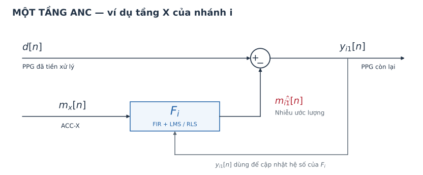
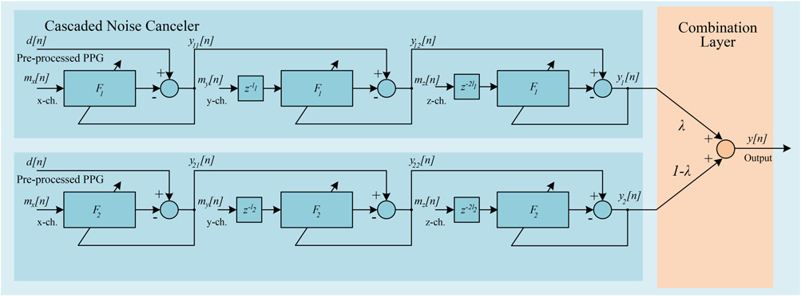
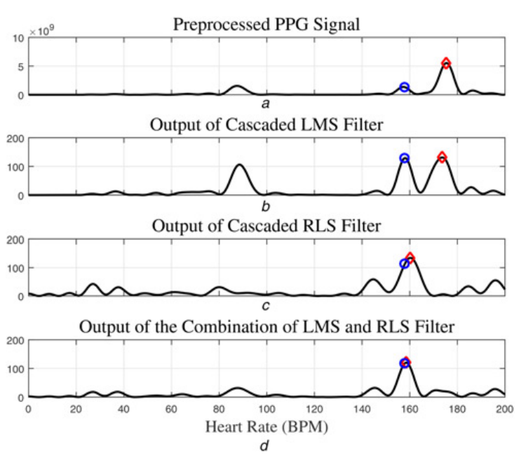

# Mục 3.2 — Hiểu kiến trúc CPC từ ANC, LMS và RLS

**Nguồn:** Islam và cộng sự, *Healthcare Technology Letters* (2018), mục 3.2, Hình 2–5, công thức (1)–(2); tham số đối chiếu mục 4.1. [Mở paper](<../../Healthcare Tech Letters - 2018 - Islam - Cascade and parallel combination  CPC  of adaptive filters for estimating heart.pdf>).

**Ý tưởng:** mỗi nhánh khử nhiễu lần lượt theo ba trục gia tốc; hai nhánh dùng LMS/RLS rồi phối hợp đầu ra để làm rõ thành phần nhịp tim.

## 1. Vì sao cần tham chiếu gia tốc?

Đỉnh nhiễu chuyển động có thể mạnh hơn và nằm sát đỉnh nhịp tim trong phổ PPG. Mục 3.2 dùng mô hình đơn giản:

$$
\boxed{m[n]=a_xm_x[n]+a_ym_y[n]+a_zm_z[n]}\tag{1}
$$

- $m[n]$: nhiễu chuyển động trong PPG; $m_x[n],m_y[n],m_z[n]$: ba tín hiệu gia tốc.
- $a_x,a_y,a_z$: hệ số biểu diễn mức đóng góp của chuyển động từng hướng.

Mô hình này giải thích vì sao ACC cung cấp thông tin về nhiễu. Tác giả chọn **xử lý riêng từng trục, nối tiếp các tầng ANC**, nhằm hạn chế làm suy giảm đỉnh tim khi khử nhiễu gần nó.

## 2. Một tầng ANC làm gì?

*Minh họa tầng đầu của nhánh $i$. $d[n]$ là PPG đã tiền xử lý; $F_i$ là loại bộ lọc thích nghi. Ký hiệu $\widehat m_{i1}[n]$ được thêm để chỉ nhiễu ước lượng.*

Một tầng thực hiện hai việc:

1. **Lọc ACC:** tạo ước lượng phần nhiễu liên quan đến tham chiếu.
2. **Trừ khỏi đầu vào chính:** giữ lại tín hiệu đưa sang tầng kế tiếp; dùng chính phần còn lại để cập nhật bộ lọc.

Với ký hiệu nền tảng bổ trợ:

$$
\widehat m[n]=\mathbf w^T[n]\mathbf u[n],
\qquad e[n]=\text{đầu vào chính}-\widehat m[n].
$$

$\mathbf u[n]$ gồm các mẫu ACC hiện tại và quá khứ; $\mathbf w[n]$ là các hệ số FIR; $T$ là chuyển vị. Số phần tử của hai véc-tơ bằng nhau.

**Điểm dễ nhầm:** đầu ra ANC thường gọi là $e[n]$, nhưng Hình 3 gọi chúng là **$y_{i1}[n],y_{i2}[n],y_i[n]$**. Đây là PPG còn lại sau phép trừ, còn nhiễu ước lượng nằm ở đầu ra của khối $F_i$ trước phép trừ.

ANC cần tham chiếu liên quan đến nhiễu và ít liên quan đến thành phần tim cần giữ. Vì vậy, giảm năng lượng đầu ra chỉ hữu ích khi vẫn bảo toàn thông tin nhịp tim.

## 3. LMS và RLS nằm ở đâu trong ANC?

Chúng là **hai cách cập nhật hệ số của $F_i$**; cùng dùng phép lọc và phép trừ ở trên.

| Core | Cách điều chỉnh hệ số | Vai trò trong CPC |
|---|---|---|
| LMS | Theo gradient từ sai số tức thời | Ba tầng của nhánh $F_1$ |
| RLS | Bình phương tối thiểu có trọng số, cập nhật đệ quy | Ba tầng của nhánh $F_2$ |

**LMS:**

$$
\mathbf w[n+1]=\mathbf w[n]+\mu e[n]\mathbf u[n].
$$

$\mu$ là bước cập nhật: quyết định mức thay đổi hệ số từ sai số hiện tại.

**RLS chuẩn có hệ số quên:**

$$
\begin{aligned}
\mathbf k[n]&=\frac{\mathbf P[n]\mathbf u[n]}
{f+\mathbf u^T[n]\mathbf P[n]\mathbf u[n]},\\
\mathbf w[n+1]&=\mathbf w[n]+\mathbf k[n]e[n],\\
\mathbf P[n+1]&=\frac{\mathbf P[n]-\mathbf k[n]\mathbf u^T[n]\mathbf P[n]}{f}.
\end{aligned}
$$

$f$ giảm trọng số của dữ liệu cũ; $\mathbf P$ là nghịch đảo ma trận tương quan đầu vào có trọng số; $\mathbf k$ là véc-tơ điều chỉnh hệ số. **Mỗi tầng có hệ số và trạng thái riêng.**

*Các công thức core và ký hiệu $\mathbf u,\mathbf w,e,\mu,f,\mathbf P,\mathbf k,\widehat m$ là phần giải thích bổ trợ; mục 3.2 không viết các phương trình cập nhật này.*

## 4. Cascade: ba tầng khử nhiễu nối tiếp

*Hình 3 nguyên bản, trang 20; ảnh được trích trực tiếp từ PDF, giữ nguyên ký hiệu và đường nối. Mỗi tầng ANC gồm $F_i$, phép trừ và nhánh cập nhật. Trong cấu hình thí nghiệm, nhánh trên dùng LMS, nhánh dưới dùng RLS.*

Luồng trong **mỗi nhánh $i\in\{1,2\}$**:

| Tầng | Đầu vào chính | Tham chiếu tại bộ lọc theo Hình 3 | Đầu ra sau phép trừ |
|---|---|---|---|
| X | $d[n]$ | $m_x[n]$ | $y_{i1}[n]=d[n]-\widehat m_{i1}[n]$ |
| Y | $y_{i1}[n]$ | $m_y[n-l_i]$ | $y_{i2}[n]=y_{i1}[n]-\widehat m_{i2}[n]$ |
| Z | $y_{i2}[n]$ | $m_z[n-2l_i]$ | $y_i[n]=y_{i2}[n]-\widehat m_{i3}[n]$ |

**Cách đọc:** tầng Y tiếp tục xử lý phần còn lại của tầng X; tầng Z tiếp tục xử lý phần còn lại của tầng Y. Ba tầng cùng học quan hệ giữa ACC và nhiễu trong đầu vào của mình.

Hình 3 đặt $z^{-l_i}$ trước tham chiếu Y và $z^{-2l_i}$ trước tham chiếu Z: đây là các phép trễ $l_i$ và $2l_i$ mẫu. Paper gọi $l_i$ là **order** của bộ lọc; chưa mô tả đầy đủ cách xử lý căn chỉnh và biên mẫu. Vì vậy, cần giữ các khối này khi đọc sơ đồ, tránh tự suy ra quy tắc triển khai từ bậc lọc.

## 5. Parallel: phối hợp hai đầu ra đã khử nhiễu

Hai nhánh nhận **cùng $d[n]$ và ba kênh ACC**, nhưng có cách thích nghi khác nhau. Các đầu ra cuối là $y_1[n]$ và $y_2[n]$:

$$
\boxed{y[n]=\lambda y_1[n]+(1-\lambda)y_2[n]},
\qquad \lambda\in[0,1].\tag{2}
$$

| $\lambda$ | Đóng góp vào $y[n]$ |
|---|---|
| $1$ | Chỉ nhánh 1 |
| $0$ | Chỉ nhánh 2 |
| $0{,}5$ | Hai nhánh có trọng số bằng nhau |

Khi cả hai nhánh cùng giữ thành phần tim, tổng trọng số bằng 1 giữ nguyên phần đó. Các sai lệch khác nhau có thể giảm khi phối hợp. Paper **cộng hai tín hiệu theo thời gian**; không lấy trung bình hai nhịp tim đã ước lượng hay hai phổ công suất.

**Ký hiệu cần phân biệt:** $y_{11},y_{12},y_1$ thuộc nhánh 1; $y_{21},y_{22},y_2$ thuộc nhánh 2; $y$ là đầu ra CPC. $\lambda$ là trọng số phối hợp, độc lập với hệ số quên $f$ trong công thức RLS bổ trợ.

## 6. Tham số paper công bố và giới hạn diễn giải

Mục 4.1 báo cáo cấu hình dùng cho kết quả:

| Nhánh / lớp | Ký hiệu kiến trúc | Giá trị công bố |
|---|---|---|
| LMS | $F_1$, order $l_1$ | Order **27**; “step size” **0.0001** |
| RLS | $F_2$, order $l_2$ | Order **55**; “step size” **0.999** |
| Phối hợp | $\lambda$ | Cố định **0.5** |

Paper gọi cả **0.0001 và 0.999** là “step size”, không đưa quy tắc cập nhật chi tiết. Gắn $\mu=0.0001$ cho LMS và diễn giải $f=0.999$ là hệ số quên RLS là cách liên hệ với core chuẩn; riêng diễn giải RLS cần được ghi rõ. Paper cũng chưa xác định đầy đủ quy ước **order / số hệ số**, khởi tạo $\mathbf P$ và trạng thái giữa các cửa sổ.

**Phần thích nghi nằm trong sáu bộ lọc; $\lambda=0.5$ không được tự cập nhật trong cấu hình công bố.**

## 7. Đọc minh họa hiệu quả trong mục 3.2

*Hình 4, trang 21: vòng tròn xanh đánh dấu nhịp tim tham chiếu; hình thoi đỏ đánh dấu đỉnh phổ lớn nhất. Đọc sự trùng vị trí hai dấu; các hàng có thang công suất khác nhau.*

| Phổ | Quan sát trong ví dụ |
|---|---|
| (a) Sau tiền xử lý | Đỉnh nhiễu mạnh hơn đỉnh tim. |
| (b) LMS | Nhiễu giảm nhưng đỉnh nhiễu vẫn trội. |
| (c) RLS | Đỉnh tim chưa tách rõ khỏi đỉnh lân cận. |
| (d) CPC, $\lambda=0.5$ | Đỉnh lớn nhất trùng vị trí nhịp tim tham chiếu. |

Ví dụ cho thấy **phối hợp hai nhánh giúp chọn đúng đỉnh tim trong cửa sổ này**. Đây là minh chứng thực nghiệm; kiến trúc không bảo đảm luôn khử hết nhiễu. Sau khối CPC, $y[n]$ mới được đưa sang ước lượng và theo dõi nhịp tim ở mục 3.3.

## 8. Motivation — Vì sao ba tầng nối tiếp và hai nhánh song song?

**Hai phần giải quyết hai vấn đề khác nhau:** nối tiếp khai thác **ba hướng chuyển động**; song song khai thác **hai cách thích nghi**. Đây là lựa chọn thiết kế của paper, được thực nghiệm hỗ trợ; chưa phải cấu trúc bắt buộc hay tối ưu đã được chứng minh.

### 8.1. Vì sao ba tầng ANC nối tiếp?

- **Ba tầng tương ứng ba trục ACC.** Theo mô hình (1), nhiễu có đóng góp từ $m_x,m_y,m_z$. Chỉ dùng một trục có thể bỏ sót thông tin chuyển động ở các hướng còn lại.
- **Mỗi tầng xử lý phần còn lại.** Tầng X tạo $y_{i1}$; tầng Y học quan hệ giữa tham chiếu Y và phần nhiễu còn trong $y_{i1}$; tầng Z tiếp tục trên $y_{i2}$. Ba tầng có tham chiếu và hệ số riêng.
- **Giữ riêng thông tin từng hướng.** Cộng cố định ba kênh ACC trước khi lọc có thể làm mất thông tin do các thành phần triệt tiêu nhau. Mục 3.2 còn nêu nguy cơ làm suy giảm đỉnh tim khi khử nhiễu có đỉnh gần nó. Tác giả vì vậy chọn khử nhiễu từng hướng theo chuỗi.

**Cách nói chính xác:** “Dùng ba tầng vì có ba tham chiếu theo ba trục; mỗi tầng tiếp tục giảm phần nhiễu liên quan đến tham chiếu của mình.” Mục tiêu không phải lặp cùng một bộ lọc ba lần.

### 8.2. Vì sao thêm hai nhánh LMS/RLS song song?

Một chuỗi ba tầng vẫn phụ thuộc vào thuật toán cập nhật: LMS dùng sai số tức thời, RLS dùng thông tin tương quan và bình phương tối thiểu có trọng số. Vì thế, hai chuỗi có thể còn những sai lệch khác nhau.

**RLS không luôn tốt hơn LMS trong dữ liệu paper:** ở người số 3, AAE của LMS là **0,66**, RLS là **1,03 BPM** (Bảng 1). Đây là cơ sở thực nghiệm để cân nhắc phối hợp thay vì chỉ giữ một thuật toán.

Hai nhánh cùng nhận $d[n]$, tạo $y_1[n],y_2[n]$ để phối hợp theo (2). Khi cả hai giữ được thành phần tim, tổng trọng số bằng 1 giữ nguyên phần chung đó; phần nhiễu còn lại có thể giảm nếu các sai lệch bổ trợ nhau. Hình 4 minh họa trường hợp đầu ra phối hợp làm rõ đỉnh tim hơn từng nhánh riêng.

**Bằng chứng của paper — Bảng 1, trang 22:**

| Cấu hình | AAE trung bình (BPM) |
|---|---:|
| Chỉ chuỗi LMS ba tầng | 13,95 |
| Chỉ chuỗi RLS ba tầng | 2,43 |
| CPC phối hợp hai chuỗi | **1,12** |

Các kết quả này hỗ trợ lợi ích của **phối hợp hai chuỗi đã chọn** trên bộ dữ liệu thử nghiệm; chưa tách riêng lợi ích của số tầng và thứ tự trục.

### 8.3. Nếu giảng viên hỏi sâu hơn

| Câu hỏi | Trả lời có căn cứ |
|---|---|
| Ba tầng và thứ tự X → Y → Z có tối ưu không? | Paper chọn theo ba trục ACC, chưa so sánh đầy đủ số tầng hoặc các thứ tự khác để kết luận tối ưu. |
| Có thể dùng một ANC nhận cả ba trục không? | Có, đó là một kiến trúc khác. Giữ riêng ba tham chiếu không bắt buộc phải mắc nối tiếp; paper chưa chứng minh CPC vượt mọi ANC đa đầu vào. |
| Càng nhiều tầng hoặc nhánh càng tốt? | Cần thực nghiệm kiểm chứng. Thêm bộ lọc tăng chi phí; tham chiếu không phù hợp còn có thể làm suy giảm thành phần tim. |
| Phối hợp luôn tốt hơn từng nhánh? | Hiệu quả phụ thuộc các sai lệch còn lại và $\lambda$; Bảng 1 cho thấy lợi ích trung bình, không bảo đảm cho mọi cửa sổ. |

### 8.4. Câu trả lời ngắn khi bảo vệ

> Ba tầng tương ứng với ba trục gia tốc. Mỗi tầng ANC dùng một trục để ước lượng nhiễu và truyền phần PPG còn lại cho tầng sau. Hai chuỗi LMS và RLS chạy song song vì có cách thích nghi khác nhau; phối hợp đầu ra giúp giảm phụ thuộc vào hạn chế của từng thuật toán. Trong paper, CPC đạt AAE trung bình thấp hơn hai chuỗi riêng. Đây là lựa chọn thiết kế có thực nghiệm hỗ trợ, chưa phải bằng chứng rằng cấu trúc này tối ưu trong mọi trường hợp.

## 9. Lựa chọn tham số trong đồ án

**Nguyên tắc:** giữ cấu hình công bố để đối chiếu paper; những chi tiết chưa được mô tả đủ phải được chốt thành quy ước triển khai. Giá trị dưới đây đối chiếu với mã hiện tại; phần giải thích nêu ý nghĩa và đánh đổi, không khẳng định chúng đã được tối ưu.

### 9.1. Dữ liệu và tiền xử lý

| Tham số | Giá trị đồ án | Vì sao dùng / ý nghĩa |
|---|---|---|
| Tần số lấy mẫu $F_s$ | **125 Hz** | Theo dữ liệu và mục 2 của paper; dùng để đổi mẫu sang thời gian, tần số sang BPM. |
| Cửa sổ / bước dịch | **8 s / 2 s**, chồng lấn **6 s** | Theo giao thức paper; mỗi cửa sổ có **1.000 mẫu**, mỗi bước dịch **250 mẫu**, ghép với một nhãn BPM0. |
| Dải lọc PPG và ACC | **0,4–3,5 Hz** | Theo mục 3.1; giữ dải quan tâm. Nhiễu nằm trong dải vẫn cần ANC xử lý. |
| FFT tiền xử lý | **1.000 điểm**, riêng từng cửa sổ | Quy ước đồ án: bỏ hệ số phổ ngoài dải rồi biến đổi ngược; không đệm thêm số 0, không thêm hàm cửa sổ phổ. |

Hai PPG được lọc riêng rồi lấy trung bình theo mục 3.1. [Cấu hình tiền xử lý](../../../src/cpc_ppg/preprocessing/config.py) và [giao thức chia cửa sổ](../../../src/cpc_ppg/data/protocol.py) quy định các giá trị này.

### 9.2. LMS, RLS và trọng số phối hợp

Trong mục này, **$M$ là số hệ số FIR trong mã**; cần phân biệt với ký hiệu **order $l_i$** của paper.

| Tham số | Giá trị đồ án | Vì sao dùng / tác động |
|---|---|---|
| Bước cập nhật LMS $\mu$ | **0.0001** | Giữ giá trị paper. $\mu$ nhân với $e[n]\mathbf u[n]$, điều khiển độ lớn bước thay đổi hệ số. |
| Số hệ số LMS / RLS | **27 / 55** mỗi tầng | Giữ hai con số công bố; đồ án hiểu là số hệ số, tương ứng bậc FIR **26 / 54**. Cách đếm này là quy ước tái hiện. |
| Hệ số quên RLS $f$ | **0.999** | Diễn giải con số paper bằng RLS có hệ số quên. Trọng số mẫu cũ giảm theo $f^k$ sau $k$ bước; $f$ gần 1 làm quên chậm. |
| Trọng số CPC $\lambda$ | **0.5** | Theo cấu hình chính của paper: hai đầu ra đóng góp **50/50**, giữ cố định trên mọi cửa sổ. |

**Vì sao đúng các con số này?** Mục tiêu ban đầu là tái hiện cấu hình paper. Chưa có cơ sở để gọi 27/55, $\mu=0.0001$ hoặc $f=0.999$ là tối ưu cho dữ liệu khác. Riêng tính ổn định của LMS còn phụ thuộc biên độ và tương quan ACC; bước cập nhật nhỏ không tự bảo đảm hội tụ.

Đối chiếu [cấu hình bộ lọc](../../../src/cpc_ppg/adaptive_filters/config.py) và [cấu hình CPC](../../../src/cpc_ppg/adaptive_filters/cpc.py). Cách diễn giải “step size” của RLS được phân biệt ở mục 6.

### 9.3. Các quy ước khởi tạo và trạng thái

| Lựa chọn trong mã | Ý nghĩa / đánh đổi |
|---|---|
| $\mathbf w[0]=\mathbf 0$; lịch sử ACC trước đầu cửa sổ bằng 0 | Bắt đầu khi chưa biết quan hệ ACC–nhiễu; các mẫu đầu phải trải qua quá trình thích nghi. |
| $\mathbf P[0]=\mathbf I_{55}$ | Ma trận đơn vị $55\times55$, chọn thang khởi tạo bằng 1 và đối xử đồng đều các hướng hệ số. Đây là lựa chọn đồ án; paper chưa cho giá trị khởi tạo. |
| Khởi tạo lại mỗi tầng ở mỗi cửa sổ 8 s | Các cửa sổ có trạng thái bộ lọc riêng, dễ tái lập; đổi lại không kế thừa hệ số đã học ở cửa sổ trước. |
| Tham chiếu X → Y → Z, không đặt trễ Y/Z tường minh | Mã hiện đưa từng kênh ACC trực tiếp vào mỗi tầng. **Chi tiết này khác các khối trễ ở Hình 3**, cần ghi nhận khi đánh giá mức tái lập. |

Các lựa chọn này được thể hiện trong [cascade.py](../../../src/cpc_ppg/adaptive_filters/cascade.py), [lms.py](../../../src/cpc_ppg/adaptive_filters/lms.py) và [rls.py](../../../src/cpc_ppg/adaptive_filters/rls.py); không gán chúng thành quy định của tác giả.

### 9.4. Ước lượng nhịp tim sau CPC

| Tham số | Giá trị đồ án | Vì sao dùng / ý nghĩa |
|---|---|---|
| Số điểm FFT ước lượng $N_F$ | **4096** | Theo mục 4.1. Mã đệm thêm số 0 cho đoạn 1.000 mẫu để có lưới tần số dày hơn. |
| Dải chọn đỉnh | **0,4–3,5 Hz** | Quy ước đồ án, cùng dải quan tâm của tiền xử lý. |
| Bán kính tìm đỉnh $\Delta_s$ | **10** vị trí FFT mỗi phía | Theo mục 4.1; tìm quanh đỉnh cửa sổ trước, giới hạn trong dải chọn đỉnh. Tương đương khoảng **±18,31 BPM** với cấu hình này. |
| Trọng số làm mượt | **0,90 / 0,05 / 0,05** | Theo mô tả mục 3.3: ưu tiên hiện tại, bổ sung hai cửa sổ trước để giảm dao động. Mã dùng các BPM thô. |
| Hậu xử lý dùng cửa sổ tương lai | **Tắt** trong cấu hình chính | Giữ đánh giá chính chỉ sử dụng cửa sổ hiện tại và trước đó; bước bổ sung của paper được tách riêng. |

**Hai FFT có nhiệm vụ khác nhau:** 1.000 điểm để lọc phổ đầu vào; 4.096 điểm để tìm tần số nhịp tim sau CPC. Đệm số 0 làm dày lưới tính toán, **không thêm dữ liệu quan sát**: mỗi đoạn vẫn dài 8 s. Khoảng cách lưới sau CPC là $125/4096\approx0,03052$ Hz, tương đương **1,831 BPM**; đây không phải cam kết độ chính xác 1,831 BPM.

Quy ước khởi động: cửa sổ đầu chọn đỉnh mạnh nhất trong dải; hai BPM đầu chưa làm mượt; khi các đỉnh bằng nhau, chọn tần số thấp hơn. Đây là các quy tắc triển khai được chốt trong [cấu hình HR](../../../src/cpc_ppg/hr/config.py), [chọn đỉnh](../../../src/cpc_ppg/hr/spectral_peak.py) và [làm mượt](../../../src/cpc_ppg/hr/postprocessing.py).

### 9.5. Vì sao vẫn giữ $\lambda=0.5$ khi khảo sát cho $\lambda=0.4$ tốt hơn?

Kết quả khảo sát báo cáo trong đồ án:

| $\lambda$ | AAE trung bình (BPM) |
|---|---:|
| 0,4 | 1,280451 |
| **0,5 — cấu hình chính** | **1,282681** |

Chênh lệch chỉ **0,002230 BPM** trên tập đã khảo sát. Đồ án giữ $\lambda=0.5$ để đối chiếu cấu hình công bố; khảo sát được dùng để xem độ nhạy. Giá trị nhỏ nhất trên tập này chưa chứng minh $\lambda=0.4$ sẽ tốt nhất trên dữ liệu độc lập.

### 9.6. Câu trả lời ngắn khi bảo vệ

> Nhóm giữ các giá trị chính của paper để đối chiếu: LMS 0.0001 và 27, RLS 0.999 và 55, phối hợp 0.5. Những chỗ paper chưa nêu rõ, nhóm chốt quy ước: hiểu 27/55 là số hệ số, 0.999 là hệ số quên, khởi tạo trọng số bằng 0 và ma trận RLS bằng đơn vị. Các lựa chọn được giữ cố định để tái lập; nhóm chưa khẳng định chúng tối ưu và có ghi rõ các khác biệt với sơ đồ gốc.
